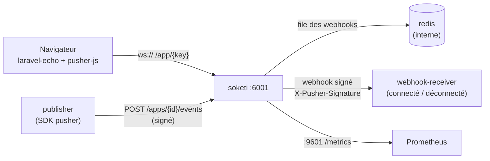

# Soketi — temps réel compatible Pusher, sans Laravel

[Soketi](https://github.com/soketi/soketi) est un serveur WebSocket auto-hébergé qui parle le **protocole Pusher**.
On réutilise donc l'outillage existant sans dépendre du service Pusher ni de Laravel :

- navigateur : `laravel-echo` + `pusher-js` ;
- backend (FastAPI, Django, Node…) : le SDK serveur `pusher` (ici Python) pour publier ;
- présence : webhooks `channel_occupied` / `channel_vacated` signés HMAC.

Ce projet fournit Soketi, une file **Redis** pour les webhooks, un **récepteur de webhooks** minimal (Python stdlib),
une **page de démo** (laravel-echo via CDN) et un **script de publication** (SDK `pusher`).

---

## Vue d'ensemble



| Service | Rôle | Réseau | Port publié |
|---|---|---|---|
| `soketi` | WebSocket `/app/` + API de publication `/apps/` + `/ready` | `edge` + `backend` | `127.0.0.1:6001`, `127.0.0.1:9601` (métriques) |
| `redis` | File des webhooks (`SOKETI_QUEUE_DRIVER=redis`) | `backend` (interne) | aucun |
| `webhook-receiver` | Vérifie la signature HMAC-SHA256 et journalise connecté / déconnecté | `backend` (interne) | aucun |
| `demo` | Page statique (nginx) abonnée à un canal de démo | `edge` | `127.0.0.1:8088` |
| `publisher` *(profil `tools`)* | Publie un événement de test avec le SDK Python `pusher` | `edge` + `backend` | aucun |

---

## Démarrage

```bash
make setup      # .env : SOKETI_APP_ID=1001 (numérique), clé et secret générés par openssl rand -hex
make up
```

Ouvrez **http://localhost:8088** : l'état passe à `connected`.

## Tests

```bash
# 1. Soketi est prêt
make ready                       # /ready → HTTP 200
# ou : curl -i http://127.0.0.1:6001/ready

# 2. Publier un événement : il s'affiche dans la page sans rechargement
make publish MSG="Bonjour"
make publish CHANNEL=demo-user.42 MSG="Nouveau rendez-vous"

# 3. Webhooks : ouvrez puis fermez l'onglet de démo
make webhooks
# webhook-receiver-1  | connecté : utilisateur 42 (demo-user.42)
# webhook-receiver-1  | déconnecté : utilisateur 42 (demo-user.42)

# 4. Métriques Prometheus
make metrics
```

Publier depuis l'hôte, sans le conteneur `publisher` :

```bash
set -a; . ./.env; set +a
uv run --with pusher scripts/publish.py demo-user.42 "Depuis l'hôte"
```

Le webhook `channel_vacated` arrive quelques secondes après la fermeture de l'onglet (fin de la connexion WebSocket).

---

## Configuration

| Variable | Rôle |
|---|---|
| `SOKETI_APP_ID` | Identifiant d'application, **numérique** |
| `SOKETI_APP_KEY` | Clé publique (connue des navigateurs) |
| `SOKETI_APP_SECRET` | Secret de signature (backend, webhooks) — jamais côté navigateur |
| `WEBHOOK_CHANNEL_PREFIX` | Préfixe des canaux qui déclenchent les webhooks (`demo-user.` ici, `private-user.` en production) |
| `SOKETI_PORT` / `SOKETI_METRICS_PORT` / `DEMO_PORT` | Ports publiés sur `127.0.0.1` |

Côté Soketi (dans `docker-compose.yml`) :

- `SOKETI_DEFAULT_APP_ENABLE_CLIENT_MESSAGES=false` : les navigateurs ne peuvent pas publier (`client-*`), seul le backend émet ;
- `SOKETI_DEFAULT_APP_WEBHOOKS` : JSON, filtré par `channel_name_starts_with` ;
- `SOKETI_QUEUE_DRIVER=redis` + `SOKETI_DB_REDIS_HOST=redis` : les webhooks passent par une file, ils ne sont pas perdus si Soketi redémarre pendant l'envoi ;
- `SOKETI_METRICS_ENABLED=1` sur le port 9601.

---

## Pièges

1. **`app_id` numérique obligatoire.** Le SDK Python `pusher` valide l'id par une expression régulière `^[0-9]+$` :
   un id textuel (`my-app`) donne `ValueError: Invalid app id` et **aucune publication ne part**. Soketi, lui, accepte
   n'importe quelle chaîne : l'erreur n'apparaît que côté backend.
2. **pusher-js + Soketi : `enabledTransports: ['ws', 'wss']`.** Soketi ne fait que du WebSocket ; sans cette option,
   pusher-js tente des replis HTTP (xhr/sockjs) qui échouent. `cluster` est exigé par pusher-js : mettez une valeur
   factice (`mt1`), Soketi l'ignore. Avec `forceTLS: true`, `wssPort` doit pointer vers le reverse proxy (443).
3. **Stats désactivées.** Soketi ne collecte pas les statistiques Pusher : `enableStats: false` côté client, et
   les métriques passent par Prometheus (`/metrics` sur 9601) uniquement.
4. **Limites de compatibilité Soketi** par rapport à l'API Pusher :
   - pas de paramètre `info` (ex. `info=subscription_count`) sur la publication ;
   - les canaux ne sont pas acceptés en *query string* sur `/events` : ils vont dans le corps JSON (ce que font les SDK) ;
   - transports `ws`/`wss` seulement ;
   - pas de collecte de stats, métriques Prometheus seulement.
5. **`listen('.notification.created')`** : le point initial empêche laravel-echo de préfixer le nom par
   `App.Events.` (convention Laravel). Sans lui, l'événement publié par un backend non-Laravel n'est jamais reçu.
6. **Réseau Docker partagé.** Le backend publie sur `http://soketi:6001` : Soketi doit être sur **le même réseau Docker**
   que le backend. Si vos backends sont sur un autre réseau que le reverse proxy, attachez Soketi aux deux — sinon
   la connexion WebSocket fonctionne et la publication échoue en silence (nom `soketi` non résolu).

---

## Production

- **N'exposer que `/app/`** derrière le reverse proxy TLS : voir [`nginx/socket.conf.example`](nginx/socket.conf.example).
  L'API de publication `/apps/…`, `/ready` et `/metrics` répondent **404** depuis Internet ; le backend les joint par le
  réseau Docker. Même signée, l'API de publication n'a aucune raison d'être publique.
- **Canaux privés** : `Echo.private('user.42')` (→ `private-user.42`) avec `authEndpoint` vers votre backend
  (équivalent du `/broadcasting/auth` de Laravel). Le backend vérifie la session et ne signe **que** le canal de
  l'utilisateur connecté (`private-user.<son id>`), refusant tout autre nom.
- **Référence, pas contenu** : un événement WebSocket transporte un id, un type, une priorité et des codes d'action ;
  titre et corps se relisent par l'API authentifiée. Un canal compromis ne divulgue alors rien de sensible.
- **Repli** : prévoyez un rafraîchissement périodique (ex. compteur relu toutes les 60 s) pour les clients sans WebSocket.
- **Webhooks = fonctionnel, pas audit.** `channel_occupied`/`vacated` reflètent l'état d'un onglet, pas une
  connexion authentifiée tracée : utilisez-les pour un journal d'activité, pas comme preuve réglementaire.
- **Secrets** : `SOKETI_APP_SECRET` uniquement côté backend et Soketi ; générez-le localement (`openssl rand -hex 32`).
- **Plusieurs instances Soketi** : passez `SOKETI_ADAPTER_DRIVER=redis` pour diffuser entre nœuds.

## Commandes

```bash
make help       # toutes les cibles
make logs SERVICE=soketi
make down       # arrêt
make clean      # arrêt + suppression du volume Redis
```

## Ressources

- [Documentation Soketi](https://docs.soketi.app)
- [Laravel Echo](https://github.com/laravel/echo) · [pusher-js](https://github.com/pusher/pusher-js) · [pusher-http-python](https://github.com/pusher/pusher-http-python)
