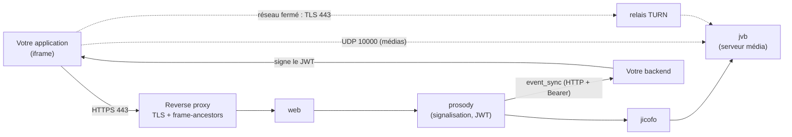

# Jitsi Meet auto-hébergé (JWT, événements de salle, TURN)

Projet : `compose/18-communication/visio/jitsi-meet/`

Une visioconférence Jitsi pensée pour être **intégrée dans une application** (iframe) : seuls les
utilisateurs munis d'un jeton signé par votre backend entrent en salle, et le backend reçoit les
événements de salle pour mesurer la présence réelle des participants.

---

## Vue d'ensemble



| Service | Rôle | Ressources au repos |
|---|---|---|
| `web` | Page de visio servie à l'iframe | ~15 Mo |
| `prosody` | Signalisation XMPP : vérifie le JWT, gère salles et modérateurs, émet les événements | ~35 Mo |
| `jicofo` | Attribue le serveur média aux participants | ~200 Mo |
| `jvb` | Serveur média (SFU) : relaie audio et vidéo sans réencoder, **UDP 10000** | ~350 Mo |
| `coturn` *(profil `turn`)* | Relais TURN pour les réseaux qui bloquent l'UDP | ~50 Mo |

En consultation : ~0,1-0,2 cœur et ~5-8 Mbit/s par visio à deux (720p). Images : ~3 Go.

---

## Démarrage

```bash
cd compose/18-communication/visio/jitsi-meet
make setup        # .env + secrets aléatoires (JWT, comptes XMPP, jeton event_sync)
```

Renseigner dans `.env` :

| Variable | Valeur |
|---|---|
| `PUBLIC_URL` | `https://meet.example.com` (URL publique, derrière le reverse proxy) |
| `JVB_ADVERTISE_IPS` | IP publique du serveur (annoncée aux navigateurs pour les médias) |
| `JWT_APP_ID` | identifiant de votre application (= `iss` des jetons) |

```bash
make up
make health
make token ROOM=salle-test NAME="Dr Test" MOD=1   # ouvre cette URL dans le navigateur
```

Ouvrir **UDP 10000** vers le serveur (pare-feu de l'hôte et de l'hébergeur). Le port web
(`127.0.0.1:8000`) ne doit jamais être exposé : Docker contourne `ufw`, d'où le bind sur la boucle locale.

Reverse proxy : `nginx/meet.conf.example` (TLS, WebSockets `/xmpp-websocket` et `/colibri-ws`).

---

## Accès par jeton (JWT HS256)

`ENABLE_AUTH=1`, `AUTH_TYPE=jwt`, `ENABLE_GUESTS=0` : sans jeton valide, pas de salle. Votre backend
signe un jeton par participant avec `JWT_APP_SECRET` :

```json
{
  "aud": "jitsi", "iss": "my-app", "sub": "*",
  "room": "consultation-1234",
  "nbf": 1760000000, "exp": 1760007200,
  "context": { "user": { "id": "user-42", "name": "Dr Martin", "moderator": true } }
}
```

- `room` limite le jeton à une salle ; `nbf`/`exp` à un créneau. Un jeton pas encore valable ou
  expiré donne une **page blanche** sans message : vérifier le créneau côté backend et afficher une
  salle d'attente plutôt que l'iframe.
- `context.user.id` est renvoyé tel quel dans les événements de salle : c'est la clé qui relie une
  présence à un utilisateur de votre application.
- `scripts/jwt.py` montre la signature (bibliothèque standard Python).

---

## Événements de salle (`event_sync`)

Le module `event_sync` (jitsi-contrib, déjà présent dans l'image `jitsi/prosody`) envoie, serveur à
serveur, un `POST` à votre backend :

| Endpoint (`EVENT_SYNC_URL` + …) | Quand |
|---|---|
| `/events/room/created` | première personne entrée |
| `/events/occupant/joined` | un participant entre (`occupant.id` = `context.user.id`, `joined_at`) |
| `/events/occupant/left` | un participant sort (`left_at`) |
| `/events/room/destroyed` | dernière personne sortie (avec `all_occupants`) |

```bash
# .env : EVENT_SYNC_URL=https://api.example.com/webhooks/jitsi
make event-sync   # génère conf.d/zz-event-sync.cfg.lua et redémarre prosody
```

Côté backend :

- vérifier `Authorization: Bearer <EVENT_SYNC_TOKEN>` (comparaison à temps constant) ;
- rendre le traitement **idempotent** (les envois sont rejoués en cas d'échec : `api_retry_count`) ;
- **ignorer** (200) une salle qui ne correspond à aucune de vos ressources : plusieurs backends
  peuvent recevoir les événements d'un même serveur Jitsi ;
- calculer la présence par intervalles (entrée → sortie) et le **chevauchement** entre participants :
  c'est la preuve qu'une consultation a réellement eu lieu.

---

## Intégration en iframe

- `@jitsi/react-sdk` (`JitsiMeeting`) ou `external_api.js` ; passer `domain`, `roomName`, `jwt`.
- `configOverwrite.subject` donne un titre lisible (sinon le nom technique de la salle s'affiche).
- Le reverse proxy pose `Content-Security-Policy: frame-ancestors` : la visio n'est intégrable que
  depuis vos domaines. Tester avec une page servie depuis une origine non autorisée : l'iframe doit
  rester vide avec une erreur CSP dans la console.
- Plein écran : le mettre sur le **conteneur** (iframe + vos boutons) plutôt que sur l'iframe, sinon
  vos boutons disparaissent.

---

## Relais TURN

Le navigateur doit joindre `jvb` en UDP. Les réseaux d'entreprise ou d'hôpital qui ne laissent
passer que HTTPS 443 donnent une salle **sans son ni image**. Un relais TURN, joint en TLS sur 443,
transmet le flux. Prosody distribue les relais aux participants (`external_services`).

### Option A — coturn local (profil `turn`)

```bash
# .env
TURN_HOST=turn.example.com
TURN_PORT=3478
TURN_TRANSPORT=udp,tcp
TURN_CREDENTIALS=<openssl rand -hex 32>   # secret partagé coturn ↔ prosody
TURN_REALM=turn.example.com
make up-turn
```

Prosody génère des identifiants temporaires à partir du secret partagé : rien à coder.
`coturn/turnserver.conf` interdit le relais vers les réseaux privés (sinon le TURN devient un proxy
vers votre infrastructure) et limite le débit par utilisateur.

Pour le TLS sur 443 (réseaux les plus fermés) : une IP dédiée, ou un multiplexage
`nginx stream` + `ssl_preread` si le 443 est déjà pris par le reverse proxy.

### Option B — service géré (ex. Cloudflare TURN)

`turn.cloudflare.com` (anycast, TLS 443 fourni), facturé au Go envoyé au client relayé. Les
identifiants s'obtiennent par API : poser un identifiant à durée limitée dans `.env` et le renouveler
avant expiration (tâche planifiée, puis `docker compose up -d prosody`).

```bash
TURNS_HOST=turn.cloudflare.com
TURNS_PORT=443
TURN_USERNAME=<username>
TURN_PASSWORD=<credential>
```

Seuls les participants qui ne joignent pas `jvb` directement passent par le relais (souvent
10-20 %) : le coût reste faible. Prévoir une alerte budget, l'identifiant étant partagé.

---

## Dépannage

| Symptôme | Cause probable |
|---|---|
| Page blanche dans l'iframe | jeton hors créneau (`nbf`/`exp`) ; `frame-ancestors` qui exclut l'origine ; navigateur sans accès au réseau local (macOS : Réglages → Confidentialité → Réseau local) pour un serveur du LAN ; antivirus qui intercepte le HTTPS |
| `config.js` en 403 | `config/web` non traversable : `chmod 0755` (fait par `make setup`) |
| event_sync ignoré au démarrage | `conf.d` illisible pour prosody (uid 100) : `chmod 0755` sur le dossier |
| Salle rejointe, ni son ni image | UDP 10000 bloqué (pare-feu, hébergeur) ou `JVB_ADVERTISE_IPS` erronée ; réseau client fermé → TURN |
| `ERR_CONNECTION_RESET` dans un seul navigateur | permission réseau local ou filtrage propre à ce navigateur |
