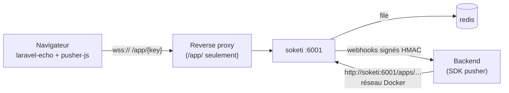

# Soketi — temps réel compatible Pusher

Projet : `compose/18-communication/realtime/soketi/`

Un serveur WebSocket auto-hébergé qui parle le **protocole Pusher** : les navigateurs utilisent `laravel-echo` +
`pusher-js`, le backend publie avec le SDK serveur `pusher` (Python, Node, PHP…), sans Laravel ni service Pusher.



## Contenu du projet

| Élément | Rôle |
|---|---|
| `soketi` | `quay.io/soketi/soketi:1.6-16-debian`, app id numérique, messages clients désactivés, métriques 9601 |
| `redis` | File des webhooks (`SOKETI_QUEUE_DRIVER=redis`), réseau interne |
| `webhook-receiver` | Script stdlib : vérifie `X-Pusher-Signature`, journalise connecté / déconnecté |
| `demo` | Page laravel-echo (canal public de démo) servie par nginx |
| `publisher` | `scripts/publish.py`, SDK Python `pusher` (profil `tools`) |
| `nginx/socket.conf.example` | Vhost de production qui n'expose que `/app/` |

## Démarrage rapide

```bash
cd compose/18-communication/realtime/soketi
make setup && make up         # http://localhost:8088
make ready                    # /ready → 200
make publish MSG="Bonjour"    # l'événement s'affiche dans la page
make webhooks                 # connecté / déconnecté
```

## Pièges principaux

- **`app_id` numérique** : le SDK Python `pusher` lève `ValueError: Invalid app id` sur un id textuel.
- **`enabledTransports: ['ws', 'wss']`** et un `cluster` factice côté pusher-js ; `enableStats: false`.
- **Limites Soketi** : pas de paramètre `info`, canaux non acceptés en query string sur `/events`, ws/wss seulement,
  métriques Prometheus uniquement.
- **Réseau Docker** : Soketi doit partager un réseau avec le backend qui publie.
- **Production** : n'exposer que `/app/` ; l'API `/apps/…` reste interne (404 depuis Internet).

Détails, tests et section production : `README.md` du projet.
